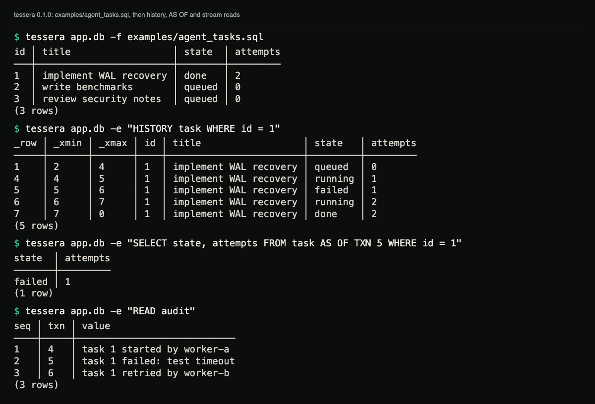
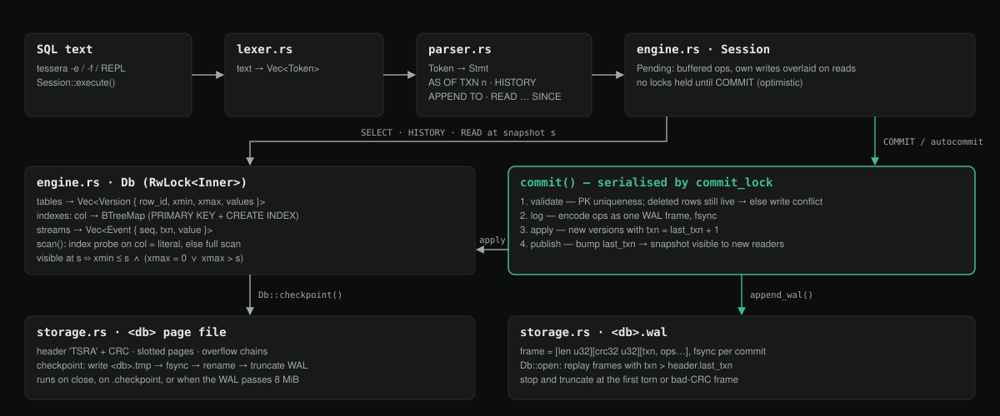

# TesseraDB

**An embedded database where the past is a first-class query.**

[Case study ↗](https://hellpuff.dev/work/tesseradb)

TesseraDB is a single-file, zero-dependency SQL database written in Rust. Every
row version is retained, so any query can be asked *as of* an earlier
transaction, and append-only event streams live in the same transactions and
the same write-ahead log as your tables.

```sql
CREATE TABLE task (id INT PRIMARY KEY, state TEXT, owner TEXT);
INSERT INTO task VALUES (7, 'queued', 'planner');
UPDATE task SET state = 'running' WHERE id = 7;      -- txn 3
UPDATE task SET state = 'failed'  WHERE id = 7;      -- txn 4
APPEND TO audit 'task 7 failed: timeout';

SELECT state FROM task WHERE id = 7;                 -- failed
SELECT state FROM task AS OF TXN 3 WHERE id = 7;     -- running
HISTORY task WHERE id = 7;                           -- all three versions, with xmin/xmax
READ audit SINCE 0;                                  -- seq, txn, value
```

With the statements above saved as `demo.sql` and applied once
(`tessera app.db -f demo.sql`), the shell shows the current state:

```
$ cargo install --path .
$ tessera app.db
TesseraDB 0.1.0 — type .help for help, .quit to exit
tessera> SELECT id, state FROM task ORDER BY id;
id │ state
───┼───────
7  │ failed
(1 row)
```

## Demo

A real terminal capture of the release binary running the bundled example,
`examples/agent_tasks.sql`, against a fresh `app.db`. Task 1 moves through
queued, running, failed, running and done. `HISTORY` shows every version with
the transactions that created (`_xmin`) and superseded (`_xmax`) it,
`AS OF TXN 5` reads the failed state back, and the `audit` stream holds the
events appended in the same transactions.



<sub>Terminal capture of `tessera` 0.1.0 (release build, macOS). Same commands and output as the block below.</sub>

```
$ tessera app.db -f examples/agent_tasks.sql
id │ title                  │ state  │ attempts
───┼────────────────────────┼────────┼─────────
1  │ implement WAL recovery │ done   │ 2       
2  │ write benchmarks       │ queued │ 0       
3  │ review security notes  │ queued │ 0       
(3 rows)
$ tessera app.db -e "HISTORY task WHERE id = 1"
_row │ _xmin │ _xmax │ id │ title                  │ state   │ attempts
─────┼───────┼───────┼────┼────────────────────────┼─────────┼─────────
1    │ 2     │ 4     │ 1  │ implement WAL recovery │ queued  │ 0       
4    │ 4     │ 5     │ 1  │ implement WAL recovery │ running │ 1       
5    │ 5     │ 6     │ 1  │ implement WAL recovery │ failed  │ 1       
6    │ 6     │ 7     │ 1  │ implement WAL recovery │ running │ 2       
7    │ 7     │ 0     │ 1  │ implement WAL recovery │ done    │ 2       
(5 rows)
$ tessera app.db -e "SELECT state, attempts FROM task AS OF TXN 5 WHERE id = 1"
state  │ attempts
───────┼─────────
failed │ 1       
(1 row)
$ tessera app.db -e "READ audit"
seq │ txn │ value                      
────┼─────┼────────────────────────────
1   │ 4   │ task 1 started by worker-a 
2   │ 5   │ task 1 failed: test timeout
3   │ 6   │ task 1 retried by worker-b 
(3 rows)
```

## What is it?

A relational engine with three things most embedded databases don't have
together:

| Capability | What it means |
|---|---|
| **Temporal by default** | Rows are never overwritten. `AS OF TXN n` reads any past snapshot; `HISTORY` shows every version of a row with the transaction that created and ended it. |
| **Event streams** | `APPEND TO stream …` / `READ stream SINCE n` are transactional, durable, ordered — and roll back with the tables they were written next to. |
| **Optimistic MVCC** | Readers never block. Writers buffer locally and validate at `COMMIT`; a conflicting concurrent write fails loudly instead of silently winning. |

It is one crate, no dependencies, ~2.5k lines, and it runs on Linux, macOS and
Windows.

## Who is it for?

- **AI agents and workflow engines** that need to answer "what did the world
  look like when the agent made that decision?" without building an audit table
  by hand.
- **Local-first applications** that want durable, transactional state and an
  event log in one file.
- **People learning how databases work.** The whole engine — pages, WAL,
  recovery, MVCC, indexes, a parser — is readable in an afternoon.

## Why does it exist?

Most embedded databases treat history as the application's problem: you add
`updated_at` columns, audit tables, triggers, and hope they stay in sync.
Systems that do version rows (Datomic, Dolt, XTDB) are large servers or JVM
runtimes. TesseraDB puts bitemporal-style *transaction time* into a file you can
`cargo add`, with an event stream next to it, because agent systems produce
both structured state and a stream of things that happened, and you usually
need to correlate them.

## What makes it different?

- **Every commit is a snapshot.** There is no "enable versioning" flag; time
  travel is how the storage works. Snapshot ids are transaction ids, so an
  event's `txn` column joins directly to the table state it was written with.
- **Streams and tables share a transaction.** `BEGIN; UPDATE …; APPEND TO …;
  COMMIT` is atomic. Roll back and the event is gone too.
- **Torn-write-safe by construction.** Every WAL frame carries a CRC; recovery
  replays up to the first bad frame and discards the rest. The page file is
  replaced atomically at checkpoint. Both are tested (`tests/recovery.rs`).
- **No dependencies.** Not even for CRC or hashing. Auditable end to end.

## Why is this not just a tutorial?

Tutorial databases stop at "parse SQL, keep a `Vec` of rows". TesseraDB has a
slotted-page file format with overflow chains for large rows, a checksummed WAL
with idempotent replay after checkpoint, MVCC visibility with a real
`(xmin, xmax)` model, optimistic conflict detection across threads, secondary
indexes that the planner actually uses for `UPDATE`/`DELETE` as well as
`SELECT`, and a fuzz suite that throws random token soup and random WAL bytes
at it. The recovery tests kill the process's view of the database *without*
checkpointing and assert on what comes back.

## Architecture



<sub>Diagram (not a screenshot) of the write and read paths through `lexer.rs`, `parser.rs` and `engine.rs`, the WAL and the page file. [ARCHITECTURE.md](ARCHITECTURE.md) has the detail.</sub>

## Benchmarks

`cargo run --release --example bench` on a Windows 11 laptop (NVMe), 0.1.0:

| Operation | Disk (fsync per commit) | In memory |
|---|---|---|
| Insert, autocommit | 506 ops/s (fsync bound) | 564 k ops/s |
| Insert, 45 k rows in one transaction | 487 k ops/s | 500 k ops/s |
| Point lookup by primary key | 833 k ops/s | 798 k ops/s |
| Indexed lookup (500 matching rows) | 27.6 k ops/s | 26.2 k ops/s |
| Full scan, 50 k rows | 893 scans/s | 601 scans/s |
| Update by primary key, autocommit | 1.09 k ops/s | 388 k ops/s |
| `AS OF` scan, 50 k versions | 5.8 k scans/s | 3.1 k scans/s |
| Checkpoint, 55 k versions | 26 ms | 22 ms |

Autocommit on disk is dominated by `fsync`; batch writes in a transaction when
you can. Numbers are from one run and will vary by machine: on a busy
Apple-silicon Mac the same command measured 219 autocommit inserts/s and
0.67 M primary-key lookups/s on disk.

## Status and limits

This is a 0.1 research-grade engine, not a drop-in SQLite replacement.
Honest limits:

- The whole database is resident in memory; the page file is the durable
  format, not a cache. Fine up to a few hundred MiB; see `ROADMAP.md`.
- SQL is a deliberate subset: no joins, no aggregates beyond `COUNT(*)`, no
  `GROUP BY`, no `ALTER TABLE`, one primary key column per table.
- History is never garbage-collected yet (`VACUUM TO TXN n` is on the roadmap).
- One process at a time may open a file; there is no file lock yet.
- `tessera -f script.sql` prints only the result of the script's last
  statement.

## Build, test, run

```
cargo build --release          # binary at target/release/tessera
cargo test                     # unit, integration, recovery, concurrency, fuzz
cargo run --release --example bench
tessera app.db -f examples/agent_tasks.sql
```

Minimum Rust: 1.88 (edition 2024). The suite is 26 integration tests in
`tests/` (`sql`, `recovery`, `concurrency`, `hostile_files`, `fuzz`) plus one
doctest; CI runs it on Linux, macOS and Windows.

### The `tessera` shell

```
tessera app.db                  interactive shell (.help, .checkpoint, .quit)
tessera app.db -e "SELECT …"    run one statement and print its result
tessera app.db -f script.sql    run a file; prints the last statement's result
tessera --memory                scratch database, nothing written to disk
```

The shell checkpoints on exit. Running `tessera` with no arguments prints the
usage line and exits with status 2.

## Using it as a library

```rust
use tesseradb::{Db, Value};

let db = Db::open(std::path::Path::new("app.db"))?;
let mut s = db.session();
s.execute("CREATE TABLE kv (k TEXT PRIMARY KEY, v TEXT)")?;
s.execute("INSERT INTO kv VALUES ('greeting', 'hello')")?;
let rows = s.query("SELECT v FROM kv WHERE k = 'greeting'")?;
assert_eq!(rows[0][0], Value::Text("hello".into()));
db.checkpoint()?;
```

`Db` is `Send + Sync`; open it once, share it in an `Arc`, and give each thread
its own `Session`.

## Documentation

- [`docs/SQL.md`](docs/SQL.md) — the dialect, statement by statement
- [`ARCHITECTURE.md`](ARCHITECTURE.md) — pages, WAL, MVCC, commit protocol
- [`TESTING.md`](TESTING.md) — what each test suite proves
- [`SECURITY.md`](SECURITY.md) — threat model and reporting
- [`ROADMAP.md`](ROADMAP.md) — what's next, in order
- [`CONTRIBUTING.md`](CONTRIBUTING.md)

## Why would you star or contribute?

Star it if you want a database you can read cover to cover and still trust with
a crash. Contribute if you want to implement a real feature end to end — a
`VACUUM`, a join, a file lock, a B-tree on disk — in a codebase small enough
that your change is visible in the architecture, not lost in it. Every issue in
the roadmap is scoped to be a single, reviewable PR.

## License

MIT. See [`LICENSE`](LICENSE).
